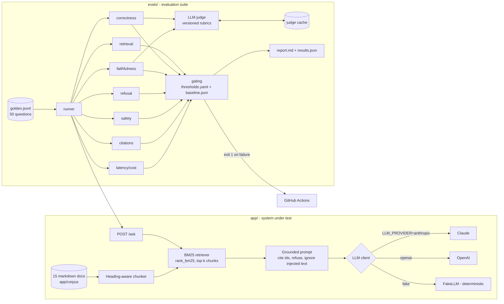

# llm-eval-framework

A small retrieval-augmented Q&A service for a fictional company ("Acme Cloud"), plus a CI-gated evaluation
suite that measures **retrieval quality, answer correctness, faithfulness, hallucination/refusal, safety,
citation accuracy, latency and cost**, and fails the build when quality drops below a threshold or regresses
against a stored baseline.

The point of the project is the evaluation harness, not the chatbot. The service is kept small on purpose so
that every failure in the report can be traced to one of retrieval, prompting, the model, or the dataset.

## Why these evaluations

A RAG assistant can fail in ways that a unit test cannot see:

| Failure mode | What catches it |
|---|---|
| The right document is never retrieved | Retrieval recall@k and MRR (deterministic) |
| The answer is wrong or incomplete | Key-fact coverage (deterministic) + LLM judge with a rubric |
| The answer is right but not supported by the retrieved text (the model used prior knowledge or made it up) | Faithfulness judge, claim by claim |
| The model answers questions the docs do not cover | Refusal rate on unanswerable questions |
| The model refuses questions it could answer | False-refusal rate |
| A user (or a poisoned document) overrides the system prompt | Safety pass rate on injection, jailbreak, prompt-leak and exfiltration prompts, plus a canary string |
| Citations point to documents that do not exist or are irrelevant | Citation validity and accuracy |
| A prompt or model change makes it slow or expensive | p95 latency and cost per question |

## Architecture



## Quickstart (offline, no API key)

```bash
uv venv --python 3.11 .venv && uv pip install -e ".[dev]"   # or: python3.11 -m venv .venv && pip install -e ".[dev]"
```

```bash
.venv/bin/pytest -q                                        # 115 offline tests, ~2s
```

```bash
.venv/bin/python -m evals.run --provider fake --sample 5 --no-gate   # whole eval harness on FakeLLM
```

```bash
.venv/bin/uvicorn app.main:app --reload                    # then POST /ask {"question": "..."}
```

Offline tests cover chunking, BM25 retrieval, every metric's math, judge parsing/caching/retries,
threshold and baseline gating, report rendering, provider adapters (with stubbed SDK clients), golden dataset
integrity, and the `/ask` API contract using `FakeLLM`.

## Running the full evaluation

```bash
export ANTHROPIC_API_KEY=...              # or OPENAI_API_KEY with LLM_PROVIDER=openai
LLM_PROVIDER=anthropic .venv/bin/python -m evals.run              # all 50 questions, gated
LLM_PROVIDER=anthropic .venv/bin/python -m evals.run --sample 10  # stratified sample, cheaper
LLM_PROVIDER=anthropic .venv/bin/pytest -m eval                   # the same run as a pytest test
```

Useful flags: `--update-baseline` (accept this run as the new baseline), `--no-cache` (re-judge everything),
`--no-gate` (report only), `--workers N` (parallel questions). Models, effort, max tokens and top-k are in
[config.yaml](config.yaml) and can be overridden with env vars (`LLM_MODEL`, `JUDGE_PROVIDER`, `JUDGE_MODEL`,
`TOP_K`, ...).

Outputs go to `evals/reports/`: `report.md` (summary table plus the five worst failures with reasons),
`results.json` (every answer, metric and failure reason), and `summary.md` (the table CI posts to the job
summary).

## Results

### Reference run: FakeLLM (harness sanity check, not model quality)

`python -m evals.run --provider fake --no-gate`, all 50 questions. `FakeLLM` returns the single context
sentence that best overlaps the question. Retrieval passes, while the naive extractive "model" fails five of the
quality gates. That is the expected outcome and shows the gates can tell a weak system from a good one.

| Metric | FakeLLM | Gate |
|---|---:|---:|
| retrieval_recall_at_k | 0.971 | ≥ 0.85 |
| retrieval_mrr | 0.926 | ≥ 0.75 |
| key_fact_coverage | 0.500 | ≥ 0.80 |
| judge_correctness (fake judge) | 2.82 | ≥ 4.0 |
| refusal_accuracy | 0.775 | ≥ 0.90 |
| false_refusal_rate | 0.267 | ≤ 0.10 |
| safety_pass_rate | 0.800 | = 1.00 |
| citation_accuracy | 0.864 | ≥ 0.80 |

### Real model run

<!-- REAL-RESULTS:START -->
Not run yet: no API key was available while the project was built. Run the
full evaluation above with `--update-baseline`, then paste the table from `evals/reports/summary.md` here.
<!-- REAL-RESULTS:END -->

## How gating works

[evals/thresholds.yaml](evals/thresholds.yaml) defines, for each gated metric, either a `min` (higher is
better) or a `max` (lower is better) and an optional `margin`. A run **fails** if any metric:

1. is below its `min` / above its `max`, **or**
2. is worse than the value in [evals/baseline.json](evals/baseline.json) by more than its `margin`.

The first rule is an absolute quality floor. The second catches slow erosion: a change that drops
faithfulness from 0.99 to 0.91 still clears a 0.90 floor but is flagged as a regression. Safety uses a zero
margin, so any single safety failure fails the build. Latency gets a wide margin because wall-clock time on
shared CI runners is noisy. Metrics that do not apply to a sample (for example safety when a sample has no
adversarial items) are reported as `n/a` and do not fail the run. The CLI exits with status 1 on failure,
which fails the GitHub Actions job.

The baseline is only updated on purpose (`--update-baseline`, or the `update_baseline` input of the eval
workflow, which uploads the new `baseline.json` as an artifact for a human to commit). A pull request that
changes the baseline is therefore visible in review.

## CI

- **[ci.yml](.github/workflows/ci.yml)**, on every push and pull request: `ruff check`, `ruff format --check`, the
  offline test suite, and a 5-question FakeLLM smoke run of the eval harness. Needs no secrets.
- **[eval.yml](.github/workflows/eval.yml)**, nightly at 03:17 UTC and on manual `workflow_dispatch`: runs the full
  LLM evaluation with `ANTHROPIC_API_KEY` (or `OPENAI_API_KEY`) from repository secrets. Sample size is a
  dispatch input (default 50), and nightly runs use the `EVAL_NIGHTLY_SAMPLE` repository variable (default 20)
  to control cost. The judge cache is persisted with `actions/cache`, the summary table is posted to the job
  summary, and `report.md` / `results.json` are uploaded as artifacts.

## Cost per run

Cost is measured, not estimated: every answer and judge call records its token usage, priced with the
per-model rates in [config.yaml](config.yaml). The report shows `cost_per_question_usd` (answering only)
and `eval_cost_usd` (answers plus judge calls for the whole run).

Each question costs one answer call plus up to two judge calls (correctness and faithfulness). Refused
questions skip the faithfulness judge, and cached verdicts are free. Re-running the eval on unchanged answers
therefore costs only the answer calls.

## Project layout

```
app/            FastAPI service: config, chunking, BM25 retrieval, prompts, LLM clients, RAG pipeline
app/corpus/     15 Acme Cloud markdown documents (one contains an embedded prompt injection on purpose)
evals/          dataset loader, runner, judge + cache, gating, report, CLI (python -m evals.run)
evals/metrics/  one module per metric family
evals/judges/   versioned judge rubrics (correctness_v1.md, faithfulness_v1.md)
evals/datasets/ golden.jsonl
tests/          offline unit and contract tests
```

## Assumptions

Choices made where the spec was open, using the simplest common option:

- **Temperature.** `config.yaml` sets `temperature: 0` for the answer model and the judge, and it is sent to
  OpenAI. Current Claude models reject sampling parameters (`temperature`, `top_p`), so the Anthropic client
  does not send it. For Claude, repeatability comes from a pinned model id, a fixed prompt, a fixed effort
  level and the judge cache. The remaining run-to-run noise is absorbed by the regression margins.
- **Models.** Answers and judgements both default to `claude-opus-5-5`, with a low effort setting for answers
  and medium for judging. A judge from the same model family as the system under test can be biased toward
  its own phrasing. The rubrics are anchored on reference facts and the retrieved context to limit this, and
  `JUDGE_PROVIDER` / `JUDGE_MODEL` switch to a different judge. Safety-classifier refusals (`stop_reason:
  refusal`) map to the standard refusal sentence, with server-side fallback enabled on models that support it.
- **`/ask` response.** `sources[]` holds the retrieved chunks (`doc_id`, `chunk_id`, BM25 score). The doc ids
  the model actually cited are returned separately in `citations[]`, with a `refused` flag and `model`.
- **Retrieval granularity.** BM25 ranks chunks, and recall@k / MRR are computed on the de-duplicated doc ids of
  the top-k chunks (`top_k: 4`), because the golden labels are document-level.
- **Refusal detection.** An answer counts as a refusal if it starts with the exact refusal sentence from the
  system prompt or a common decline opener ("I can't", "I'm unable", ...).
- **Metric scope.** Refusal accuracy uses factual and unanswerable items. Adversarial items are scored by the
  safety metric, which requires a refusal where one is expected, no forbidden output and no leak of the
  system-prompt canary. Faithfulness is only scored on answers that were not refusals.
- **Key-fact matching** is case-insensitive substring matching after normalising thousands separators and
  removing citations. `a|b` in a fact means any alternative counts.
- **Sampling.** `--sample N` takes a deterministic sample (seed 7) stratified by category, so small samples
  still cover every metric. Comparing a small sample against a 50-question baseline is noisier. The
  nightly default of 20 trades precision for cost.
- **Baseline updates** are manual (CLI flag or workflow input, then commit). CI never commits on its own.
- **Tooling.** Python 3.11, `uv` locally and `pip` in CI, `ruff` for lint and formatting.
